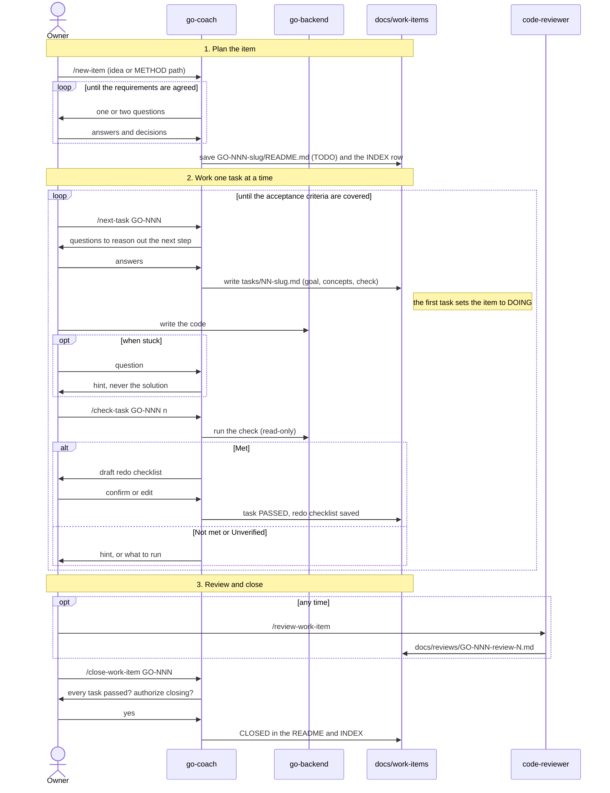

# Work flow

The question-led flow for the Go backend migration. The coach asks, you reason it out and write the code, and a check tells you whether it worked. Details are in [docs/engineering/workflow.md](docs/engineering/workflow.md).

## Statuses

| Status | Meaning |
| --- | --- |
| TODO | The item is saved and no task has started. |
| DOING | The first task has started. |
| CLOSED | Every task passed and you authorized closing. |
